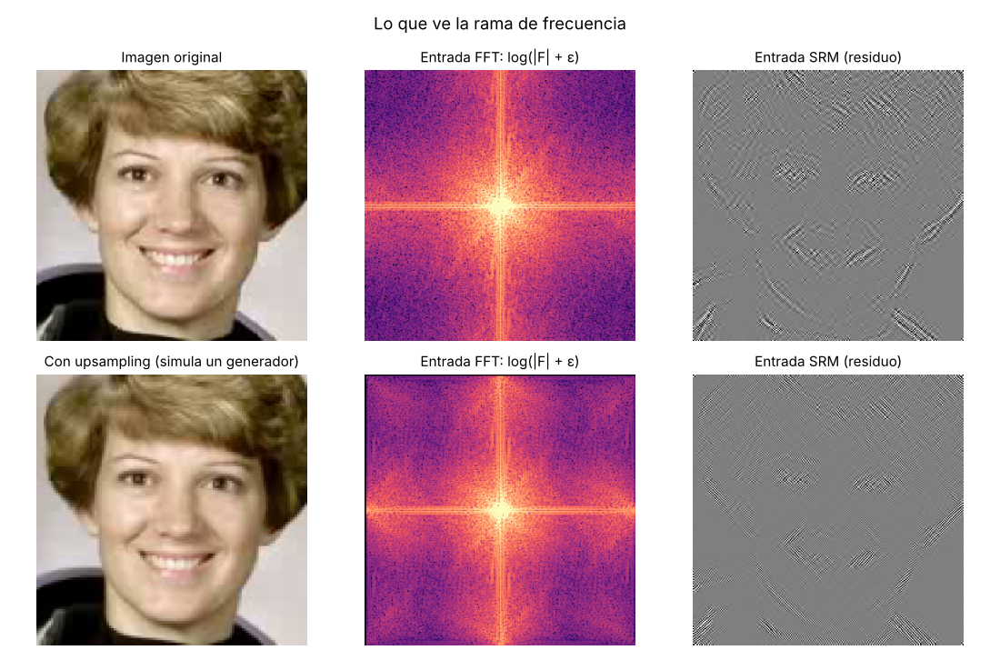

# Detección de deepfakes con redes neuronales

Proyecto del curso **Redes Neuronales y Aprendizaje Profundo** (Universidad EAFIT).

Diseñamos y entrenamos desde cero una red neuronal convolucional de dos ramas, **espacial** y **de frecuencia**, que clasifica rostros extraídos de videos como reales o manipulados. Luego la comparamos con MesoNet y con EfficientNet-B0 preentrenado, y estudiamos qué tan bien generaliza a técnicas de manipulación y datasets que no vio durante el entrenamiento.

- 📄 [Propuesta corta](docs/propuesta.md)
- 📄 [Anteproyecto completo](docs/anteproyecto.md): problema, objetivos, hipótesis, metodología, cronograma y riesgos.

## Estado

| Semana | Contenido | Estado |
|---|---|---|
| 1 | Pipeline de datos (extracción de rostros, splits sin fugas), MesoNet, entrenamiento y evaluación | ✅ Código listo — falta correr con los datos reales |
| 2 | Red propia de dos ramas, EfficientNet-B0, ablaciones (E1–E3) | ✅ Código listo — falta correr con los datos reales |
| 3 | FaceShifter (E3b), Celeb-DF (E4), Grad-CAM (E5) y demo | ✅ Código listo — falta el informe |

**Siguiente paso:** correr los notebooks de Kaggle (ver [Cómo correrlo en Kaggle](#cómo-correrlo-en-kaggle)).

## Estructura del repositorio

```
├── app/
│   └── demo.py                # Demo en Gradio: imagen o video → probabilidad + Grad-CAM
├── data/
│   └── splits/ffpp_oficial/   # División oficial de FaceForensics++ por pares de identidades
├── docs/                      # Propuesta, anteproyecto e informe
├── notebooks/
│   ├── kaggle_01_extraer_rostros.ipynb  # ⭐ Kaggle: rostros + splits (CPU)
│   ├── kaggle_02_entrenar.ipynb         # ⭐ Kaggle: todos los experimentos (GPU)
│   ├── 00_preparar_datos.ipynb          # Alternativa en Colab
│   └── 01_entrenamiento_colab.ipynb     # Alternativa en Colab
├── results/                   # Métricas de los experimentos
└── src/
    ├── data/
    │   ├── extraer_rostros.py  # Videos → recortes de rostros (detector YuNet) + manifiesto
    │   ├── crear_splits.py     # Manifiesto → train/val/test sin fugas de identidad
    │   └── dataset.py          # Dataset de PyTorch y aumentos (JPEG, desenfoque, color)
    ├── models/
    │   ├── mesonet.py          # Meso-4, línea base desde cero
    │   ├── dos_ramas.py        # Red propia: rama espacial + rama de frecuencia (FFT o SRM)
    │   └── efficientnet.py     # EfficientNet-B0 preentrenado, referencia
    ├── entrenar.py             # Entrenamiento con AMP, early stopping y checkpoints reanudables
    ├── evaluar.py              # Métricas por frame, por video y por técnica
    ├── gradcam.py              # Mapas Grad-CAM: ejemplos y promedio por técnica
    ├── metricas.py
    └── utils.py
```

## Cómo correrlo en Kaggle

El dataset ([`xdxd003/ff-c23`](https://www.kaggle.com/datasets/xdxd003/ff-c23)) ya está en Kaggle, así que no hay que descargarlo, y las corridas siguen aunque se cierre el navegador.

**Requisito:** cuenta de Kaggle verificada con el celular (*Settings → Phone verification*), para que los notebooks tengan internet y puedan clonar este repositorio.

### Notebook 1: extraer rostros (CPU)

1. En Kaggle: *Create → New Notebook → File → Import Notebook* y subir [`notebooks/kaggle_01_extraer_rostros.ipynb`](notebooks/kaggle_01_extraer_rostros.ipynb).
2. Panel derecho: **Accelerator: None**, **Internet: On**, *Add Input* → `ff-c23`.
3. *Save Version* → **Save & Run All (Commit)**.
4. Al terminar, en *Output* quedan `faces_ffpp.zip` (~5–6 GB) y `splits/`.

### Notebook 2: entrenar y evaluar (GPU)

1. Importar [`notebooks/kaggle_02_entrenar.ipynb`](notebooks/kaggle_02_entrenar.ipynb) igual que el anterior.
2. Panel derecho: **Accelerator: GPU T4 x2** (o P100), **Internet: On**, *Add Input* → *Your Work* → la salida del notebook 1.
3. *Save Version* → **Save & Run All (Commit)**.
4. Entrena la cola de experimentos con un presupuesto de 11 h por sesión (Kaggle corta a las 12 h). Si no alcanza, pausa el experimento en curso guardando el checkpoint.
5. Para continuar: nueva *Save Version*, agregando como input **la salida de la versión anterior de este mismo notebook**. Salta lo terminado y continúa lo pausado.

La GPU gratuita de Kaggle tiene una cuota de ~30 h por semana. La cola está ordenada para que lo indispensable (MesoNet, red propia y EfficientNet) termine primero.

## Uso local

### 1. Instalación

```bash
pip install -r requirements.txt
```

`src/utils.py` elige el dispositivo automáticamente: CUDA (Colab, GTX 1660) → MPS (Mac) → CPU.

### 2. Datos

Para correr localmente, FaceForensics++ (C23) se descarga de Kaggle ([`xdxd003/ff-c23`](https://www.kaggle.com/datasets/xdxd003/ff-c23)) con `kagglehub`. Se necesita un token de Kaggle (*Settings → API → Generate New Token*), guardado en `~/.kaggle/access_token` o en la variable `KAGGLE_API_TOKEN`. Más detalles en [`data/README.md`](data/README.md).

```python
import kagglehub
ruta = kagglehub.dataset_download("xdxd003/ff-c23")
```

### 3. Extraer rostros

```bash
python -m src.data.extraer_rostros --dataset ffpp --raiz <ruta de kagglehub> --salida data/faces/ffpp --procesos 8
```

- Detecta sola la estructura de carpetas (la de Kaggle o la del script oficial) e ignora `DeepFakeDetection`.
- Toma 32 frames de cada video real y 8 de cada falso: como hay 4 técnicas, las clases quedan balanceadas (~32 mil rostros de cada una).
- Guarda en PNG para no agregar compresión que confunda a la rama de frecuencia.
- Si se interrumpe, al volver a correr el comando continúa donde iba.
- Si el dataset trae **FaceShifter**, la extrae pero **nunca se usa para entrenar**: queda como técnica no vista (E3b).

Luego se empaqueta para subir a Drive: `cd data/faces && zip -r -0 faces_ffpp.zip ffpp`.

### 4. Crear los splits

```bash
python -m src.data.crear_splits --dataset ffpp --rostros data/faces/ffpp --salida data/splits/ffpp
```

Usa la división oficial de FaceForensics++ y verifica que ninguna identidad quede en dos particiones.

### 5. Entrenar y evaluar

```bash
python -m src.entrenar --modelo meso4 --datos data/faces/ffpp --splits data/splits/ffpp --salida runs/meso4
python -m src.evaluar --checkpoint runs/meso4/mejor.pt --datos data/faces/ffpp \
    --csv data/splits/ffpp/test.csv --salida results/meso4_ffpp
```

En Colab, usar [`notebooks/01_entrenamiento_colab.ipynb`](notebooks/01_entrenamiento_colab.ipynb), que corre todos los experimentos (E1–E5) y arma la tabla de resultados.

### 6. Grad-CAM y demo

```bash
python -m src.gradcam --checkpoint runs/dos_ramas/mejor.pt --datos data/faces/ffpp \
    --csv data/splits/ffpp/test.csv --salida results/gradcam/dos_ramas
python -m app.demo --checkpoint runs/dos_ramas/mejor.pt runs/meso4/mejor.pt   # --compartir en Colab
```

## Experimentos

| ID | Qué mide | Cómo |
|---|---|---|
| E1 | Rendimiento dentro de FF++ | `evaluar` en `test.csv` |
| E2 | Aporte de cada componente | Variantes `solo_espacial`, `solo_frecuencia`, `dos_ramas_sin_se`, `dos_ramas_srm` |
| E3 | Técnica no vista | `entrenar --metodos` con 3 de las 4 técnicas |
| E3b | Técnica nunca vista (FaceShifter) | `evaluar --metodos FaceShifter` |
| E4 | Otro dataset | `evaluar` en Celeb-DF v2 |
| E5 | Interpretabilidad | `gradcam` |

El Grad-CAM se validó con una prueba controlada: se entrenó una red donde lo "falso" era una mancha puesta a propósito en la boca, y el mapa la localiza.


## Modelos

| `--modelo` | Descripción | Parámetros |
|---|---|---|
| `meso4` | MesoNet, línea base desde cero | 24 mil |
| `dos_ramas` | **Red propia**: espacial + frecuencia (FFT), con atención SE | 1,63 M |
| `solo_espacial` | Ablación: sin rama de frecuencia | 1,18 M |
| `solo_frecuencia` | Ablación: sin rama espacial | 0,45 M |
| `dos_ramas_sin_se` | Ablación: sin Squeeze-and-Excitation | 1,48 M |
| `dos_ramas_srm` | Variante: rama de frecuencia con filtros SRM en lugar de FFT | 1,63 M |
| `efficientnet_b0` | Referencia preentrenada en ImageNet (usar `--lr 3e-4`) | 4,0 M |

La red propia recibe la misma imagen RGB que los demás modelos y calcula por dentro la entrada de la rama de frecuencia:



En la fila de abajo, el *upsampling* (lo que hacen los generadores de deepfakes) deja "réplicas" en el espectro de Fourier, que no se notan en la imagen.

## Datasets

- [FaceForensics++](https://github.com/ondyari/FaceForensics) (versión C23 en [Kaggle](https://www.kaggle.com/datasets/xdxd003/ff-c23)): entrenamiento, validación y prueba.
- [Celeb-DF v2](https://github.com/yuezunli/celeb-deepfakeforensics): prueba de generalización.

Se usan solo con fines académicos y según sus términos de uso. Los datos **no** se suben a este repositorio.

## Créditos de terceros

- División oficial de FaceForensics++ (`data/splits/ffpp_oficial/`), tomada del [repositorio de FaceForensics](https://github.com/ondyari/FaceForensics).
- Detector de rostros YuNet (`src/data/pesos/`), del [OpenCV Model Zoo](https://github.com/opencv/opencv_zoo/tree/main/models/face_detection_yunet) (licencia MIT).

## Integrantes

- Julián Lara Aristizábal
- _[agregar integrantes]_
